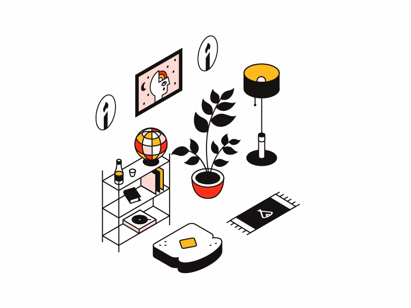

# decorar.space

**Try wall art in your real space, at real size, before you buy or hang it.**



## The story

In early 2024, before generative AI became a mainstream technology, we believed that **Augmented Reality** was a compelling way to see digital elements inside real spaces. That idea became **decorar.space**, a personal project that lets people take photos of paintings and wall art and place them on their physical walls.

The goal is simple: try artwork in your own environment, with its real dimensions, instead of trying to imagine how it would look.

## How it works

1. **Pick an image.** Take a photo of a painting or poster, upload an image, or choose one from the gallery.
2. **Configure it.** Set the real dimensions, the frame type (material, color, width and depth) and the passe-partout (mat).
3. **Generate the 3D model.** From that configuration, the app builds a 3D scene with [Three.js](https://threejs.org/) at runtime and exports it as a **GLB** model in the browser with `GLTFExporter`, with no server involved.
4. **See it in AR.** The generated GLB is loaded into Google's [`<model-viewer>`](https://modelviewer.dev/), which places it on a wall with Augmented Reality (`ar-placement="wall"`) at true scale.

> The experience works best on mobile devices with a **LiDAR** (or ToF) sensor, which gives more precise surface detection and positioning.

## Tech stack

| Area | Technology |
| --- | --- |
| Framework | [SvelteKit](https://kit.svelte.dev/) + Svelte |
| Styling | [Tailwind CSS](https://tailwindcss.com/) |
| 3D | [Three.js](https://threejs.org/), [Threlte](https://threlte.xyz/) |
| Model export | Three.js `GLTFExporter` (binary GLB generated client-side) |
| Augmented Reality | [`@google/model-viewer`](https://modelviewer.dev/) (WebXR / Scene Viewer / Quick Look) |
| Build tool | [Vite](https://vitejs.dev/) |

## Project structure

```
src/
├── lib/
│   ├── components/         # UI and 3D components (SceneMaker, SceneToGltf, controls…)
│   ├── FrameUtilies.js / FrameUtilitiesSquare.js  # Frame and passe-partout geometry
│   ├── UVProjectionUtils.js
│   ├── TextureLoaderUtilities.js / TextureCacheStore.js
│   └── *Store.js           # Svelte stores for frame, image and scene state
└── routes/
    ├── MainNavigation/     # Explore → Setup → 3D / AR flow
    └── SecondaryNavigation/# Product, resources, about and legal pages
```

## Getting started

```bash
npm install
npm run dev       # dev server, exposed on the local network (--host) for testing on a phone
npm run build     # production build
npm run preview   # preview the production build
```

AR needs a real mobile device. Because `npm run dev` runs with `--host`, you can open the app from your phone on the same network. Some browsers only allow AR over HTTPS.

## Status

decorar.space started in **January 2024** as a personal project. The commit history documents its development from the first commit.
